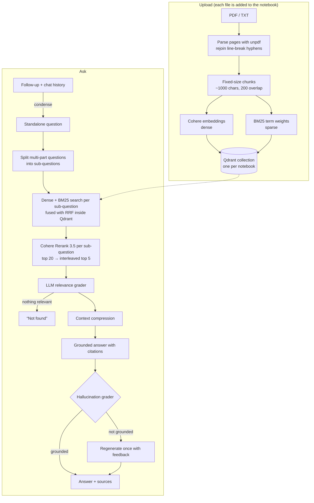

# SourceSage

[](https://github.com/31UTKARSH07-ALPHA/SourceSage/actions/workflows/ci.yml)

Upload PDFs or text files into a notebook and ask questions across them. Every answer comes only from your documents and shows the passages it used.

SourceSage is a NotebookLM-style retrieval-augmented generation (RAG) app. Every stage of its pipeline was chosen by **measuring it**: a labeled evaluation set of 56 questions over two real documents scores each retrieval and answering configuration. See [eval/RESULTS.md](eval/RESULTS.md) for the numbers and [DECISIONS.md](DECISIONS.md) for the reasoning.

## Results at a glance

On 48 answerable questions over two public PDFs (a NIST policy framework and a research paper), scored on the 5 chunks the answer generator receives:

| Retrieval setup | Evidence found (Recall@5) | Multi-part questions | First relevant chunk rank (MRR) |
|---|---:|---:|---:|
| Plain vector search, sentence-window chunks (the earlier design) | 79.2% | 60.0% | 0.650 |
| Hybrid search + reranking, fixed-size chunks | 93.1% | 76.7% | 0.864 |
| **+ query decomposition (current default)** | **96.2%** | **91.7%** | 0.829 |

Main findings:
- **Hybrid search** (embeddings + BM25 keywords) lifts recall from 81.9% to 93.1% over embeddings alone. With small chunks, embeddings found only 80% of the evidence for exact-term questions (codes, numbers), while BM25 found 100%.
- **Plain ~1000-character chunks** beat both sentence-window and semantic chunking.
- **Splitting multi-part questions** into separate searches fixed the weakest category. Multi-query rewriting added nothing.

## How it works



### Ingestion

| Step | What it does | Why |
|---|---|---|
| Parsing | `unpdf` extracts text page by page. Words split across lines ("abil- ity") are rejoined, but real hyphens like "best- and worst-case" are kept. `.txt` files are read directly. | Keeps page numbers for citations. Split words would match nothing in either keyword or vector search. |
| Chunking | **Fixed-size:** about 1000 characters with 200 characters of overlap, cut on word boundaries. Sentence-window and semantic chunking are also implemented, for comparison. | The best of the three strategies measured (93.1% evidence recall vs 86.1% and 88.9%), with less context than sentence-window and no extra upload cost. |
| Dense vectors | Cohere `embed-english-v3.0` by default. `EMBEDDING_MODEL` and `EMBEDDING_DIM` can select `embed-v4.0` at 256–1536 dimensions. Documents use `input_type: search_document` and queries `search_query`, in batches of 96. | Cohere models embed documents and queries asymmetrically, so they need different input types. |
| Sparse vectors | **BM25.** The term-frequency part (k1 = 1.2, b = 0.75) is computed at upload, and Qdrant applies IDF at query time (`modifier: "idf"`). | Embeddings miss exact identifiers ("GOVERN 1.7", "45.6%"); BM25 doesn't. |
| Notebooks | One Qdrant collection per notebook. Each upload is added to it and tagged with a document id, so a failed upload can be removed cleanly. "New notebook" deletes the collection. | Questions search across every document in the notebook, like NotebookLM. |

### Query pipeline

1. **Condense follow-ups.** With chat history, a small model rewrites "what about sales staff?" into a standalone question. History is only used to resolve references and never reaches the answer generator.
2. **Decompose.** One LLM call splits a multi-part question into 2–3 standalone sub-questions; single-part questions pass through unchanged. This raised recall on multi-part questions from 76.7% to 91.7%.
3. **Hybrid search + RRF.** Each (sub-)question is searched with both dense and BM25 vectors, and Qdrant's Query API fuses the lists with Reciprocal Rank Fusion in one request per sub-question.
4. **Rerank.** Cohere `rerank-v3.5` scores the top 20 for each sub-question. The final top 5 takes turns between sub-questions, so every part of the question is represented.
5. **Relevance grading.** One LLM call drops off-topic chunks. If nothing is left, the app answers "not found" without generating.
6. **Compression.** Only the relevant sentences of each chunk are kept, with all chunks processed in parallel.
7. **Generation.** Groq `openai/gpt-oss-120b` (configurable with `GROQ_MODEL`) answers only from numbered sources, with `[n]` citations.
8. **Grounding check.** A grader checks every claim against the sources. An ungrounded answer is regenerated once with the grader's feedback, and the verdict is shown in the UI.

Every stage can be switched on or off with `PipelineOptions` (`lib/rag.ts`). That's how the evaluation measures each stage using the app's own code.

**Live progress.** `/api/ask` streams newline-delimited JSON: a `{"type":"stage"}` event as each stage starts, then a `{"type":"result"}` (or `{"type":"error"}`) event. Answers aren't streamed token by token, because a draft that fails the grounding check is replaced.

## Evaluation

```bash
npm run eval -- retrieval        # ranking quality of each pipeline config
npm run eval -- generation       # answer correctness + faithfulness, graded by a second LLM
npm run eval -- latency          # uncached end-to-end timings
npm run eval -- report           # rebuild eval/RESULTS.md
```

- **Dataset:** 56 questions (factual, exact-keyword, multi-part, unanswerable), each labeled with exact evidence quotes.
- **Scoring:** retrieval is scored on Recall@5 and MRR. Answers are scored for correctness and faithfulness by a different model from the generator, and plain refusals are scored in code.
- **How it runs:** every API response is cached, so re-runs are free and reproducible.

The full method and its limitations are in [eval/README.md](eval/README.md).

## Tests

```bash
npm test
```

55 offline unit tests (vitest; no API keys or network) cover the deterministic parts. GitHub Actions runs them, plus the type check and production build, on every push to `main` and every pull request (`.github/workflows/ci.yml`):
- PDF text cleanup and sentence splitting
- all three chunking strategies
- BM25 vectors, including hash collisions
- query decomposition parsing and merging by turns
- citation cleanup
- the evaluation's own metrics

## Tech stack

- **App:** Next.js 14 (App Router), React, TypeScript
- **Vector DB:** Qdrant (named dense + sparse vectors, Query API fusion, collection metadata)
- **Embeddings and reranking:** Cohere `embed-english-v3.0` (or `embed-v4.0`), `rerank-v3.5`
- **LLMs:** Groq `openai/gpt-oss-120b` (pipeline) and `openai/gpt-oss-20b` (follow-up condensing, context headers, evaluation judge)
- **PDF parsing:** unpdf
- **Tests:** vitest

## Project structure

```
app/
  page.tsx                 notebook UI: sources list, chat, live stage, grounding badge, citations
  api/upload/route.ts      parse → chunk → embed → index (new notebook or add to one)
  api/ask/route.ts         streams stage events + result as NDJSON
  api/notebook/route.ts    deletes a notebook
  api/demo/route.ts        tells the UI whether demo mode (and which limits) is on
lib/
  rag.ts                   the whole RAG pipeline
eval/
  questions.json           56 labeled questions
  documents.json           evaluation PDFs (downloaded and hash-checked at run time)
  run.ts, lib.ts           harness: suites, metrics, judge, caches
  RESULTS.md               generated results tables
tests/                     offline unit tests
```

## Running locally

1. Copy `.env.example` to `.env.local` and fill it in:

   ```bash
   COHERE_API_KEY=your-cohere-api-key
   GROQ_API_KEY=your-groq-api-key
   GROQ_MODEL=openai/gpt-oss-120b         # optional
   QDRANT_URL=http://localhost:6333
   QDRANT_API_KEY=                      # only needed for Qdrant Cloud
   QDRANT_COLLECTION_PREFIX=sourcesage
   EMBEDDING_MODEL=embed-english-v3.0   # optional; or embed-v4.0
   EMBEDDING_DIM=1024                   # optional; embed-v4.0 takes 1536, 1024, 512 or 256

   # Public demo only (leave unset for local use and the evaluation)
   DEMO_MODE=true                       # turns on the limits below and the demo note in the UI
   DEMO_MAX_UPLOADS_PER_DAY=3           # per visitor (IP)
   DEMO_MAX_QUESTIONS_PER_DAY=20        # per visitor (IP)
   DEMO_MAX_QUESTIONS_TOTAL_PER_DAY=300 # all visitors together
   NOTEBOOK_TTL_HOURS=24                # notebooks older than this are deleted
   ```

   The embedding settings apply to new notebooks only. Each collection records the model and size it was built with in its Qdrant metadata, and queries and later uploads use that, so two vector spaces never mix. Smaller vectors take less space (4 bytes per dimension: 6 KB per chunk at 1536, 1 KB at 256).

2. Start Qdrant (1.10 or later, for the IDF modifier and Query API):

   ```bash
   docker run -p 6333:6333 -v "$(pwd)/qdrant_storage:/qdrant/storage" qdrant/qdrant
   ```

3. Run the app:

   ```bash
   npm install
   npm run dev
   ```

   Open `http://localhost:3000`.

## Deployment

Deploy to Vercel with the same environment variables, using Qdrant Cloud for `QDRANT_URL`.

### Live demo

Live demo: _coming soon_

A public deployment spends the owner's free API quotas, so it runs with `DEMO_MODE=true`:

- **Usage limits.** Each visitor (by IP) gets `DEMO_MAX_UPLOADS_PER_DAY` uploads (default 3) and `DEMO_MAX_QUESTIONS_PER_DAY` questions (default 20) per UTC day, and all visitors together share `DEMO_MAX_QUESTIONS_TOTAL_PER_DAY` questions (default 300). Over the limit, the API returns HTTP 429 with a message the UI shows. Code: `lib/demo-limits.ts`.
- **Upload size.** Files over 4 MB are rejected in the browser before uploading and again by the server (Vercel caps request bodies at ~4.5 MB). Code: `lib/upload-limits.ts`.
- **Notebook expiry.** Each new notebook gets a `createdAt` in its Qdrant collection metadata. On upload, at most once an hour per server instance, a background cleanup deletes notebooks older than `NOTEBOOK_TTL_HOURS` (default 24). Evaluation collections (`*_eval_*`) are never touched. Code: `lib/notebook-cleanup.ts`, `lib/notebook-ttl.ts`.
- **A note in the UI** states the limits, the expiry and asks visitors not to upload private documents.

**Limitation:** the counters are kept in memory. On Vercel each warm instance has its own counters, and they reset on a cold start or redeploy, so the limits are best-effort: enough against casual overuse and runaway loops, not against a determined abuser. Strict limits need a shared store such as Upstash Redis. Without `DEMO_MODE`, nothing is limited and nothing expires (unless `NOTEBOOK_TTL_HOURS` is set).

## Limitations

- **Free-tier limits.** Groq's free tier allows 200K tokens per model per day, and Cohere's trial key 1,000 calls per month. Bulk work like the full answer-quality evaluation needs a paid tier or several days.
- **Latency.** The default pipeline takes 6.5 s at p50 (naive retrieval: 2.7 s), so the UI streams stage progress. About half of that is the three post-retrieval checks (grading, compression, grounding check). The pending answer-quality comparison will show whether they earn it.
- **Conversation memory** covers the last 3 exchanges and lives in the browser.
- **No OCR.** Scanned (image-only) PDFs aren't supported.
- **Demo limits are per server instance** (in memory), so they're best-effort; see [Live demo](#live-demo).
