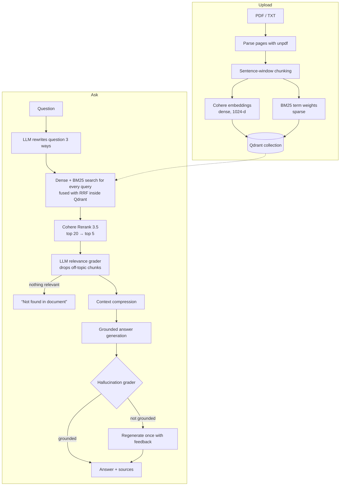

# SourceSage

Ask questions about a PDF or text file and get answers that come only from that document, with the source passages shown next to every answer.

SourceSage is a NotebookLM-style retrieval-augmented generation (RAG) app. Instead of plain top-k vector search, it uses a multi-stage pipeline: question rewriting, hybrid dense + BM25 search, cross-encoder reranking, relevance filtering, and a grounding check on the final answer.

## How it works



### Ingestion

| Step | What it does | Why |
|---|---|---|
| Parsing | `unpdf` extracts text page by page; `.txt` is read directly. | Keeps page numbers for citations. |
| Chunking | **Sentence window.** Each chunk is 2 sentences. It's stored with a wider "parent" window (2 extra sentences on each side). Text with no punctuation (tables, lists) is split on words at 500 characters. | Small chunks give precise matches; the parent window gives the LLM enough context to answer. |
| Dense vectors | Cohere `embed-english-v3.0` by default (`EMBEDDING_MODEL` / `EMBEDDING_DIM` select `embed-v4.0` at 256–1536 dimensions) with `input_type: search_document` (queries use `search_query`). Sent in batches of 96, Cohere's request limit. | Cohere v3 is trained asymmetrically, so documents and queries need different input types. |
| Sparse vectors | **BM25.** The term-frequency part (k1 = 1.2, b = 0.75, normalized by chunk length) is computed at upload. The collection uses Qdrant's `modifier: "idf"`, so Qdrant applies the inverse-document-frequency part at query time. | Embeddings miss exact terms like names, codes and numbers ("extension 4410"); BM25 catches them. |
| Storage | One Qdrant collection per document, holding both vectors. The previous document's collection is deleted when a new one is uploaded. | No cross-document leakage and no orphaned collections. |

### Query pipeline

1. **Query translation.** The LLM writes 3 rephrasings of the question. The original question is always searched as well, so a bad rewrite can only add candidates.
2. **Hybrid search + RRF.** Every query is searched against both the dense and the BM25 vectors (up to 8 ranked lists). Qdrant's Query API merges them with Reciprocal Rank Fusion in **one request**.
3. **Reranking.** The top 20 fused candidates are scored by Cohere `rerank-v3.5`, a cross-encoder that reads the question and the chunk together, and the top 5 are kept. If the rerank API fails, the fusion order is used.
4. **Relevance grading (corrective RAG).** One LLM call labels each chunk relevant or not. If nothing is relevant, the app answers "not found" without calling the generator, which prevents made-up answers.
5. **Context compression.** Chunks are compressed in parallel, keeping only the sentences relevant to the question.
6. **Generation.** Groq `openai/gpt-oss-120b` (configurable with `GROQ_MODEL`) answers using only the numbered sources.
7. **Grounding check.** A grader LLM checks whether every claim is supported by the sources. If not, the answer is regenerated once with the grader's feedback. The result (grounded / may contain unsupported claims / not found) is shown in the UI.

Each response also returns the queries used and a per-stage latency breakdown (`timingsMs`).

For the reasoning behind each design choice, including what was broken in earlier versions and how it was fixed, see [DECISIONS.md](DECISIONS.md).

## Tech stack

- **App:** Next.js 14 (App Router), React, TypeScript
- **Vector DB:** Qdrant (named dense + sparse vectors, Query API fusion)
- **Embeddings and reranking:** Cohere `embed-english-v3.0`, `rerank-v3.5`
- **LLM:** Groq `openai/gpt-oss-120b` via LangChain
- **PDF parsing:** unpdf

## Project structure

```
app/
  page.tsx              chat UI: upload, ask, sources, grounding badge
  api/upload/route.ts   parse → chunk → embed → index
  api/ask/route.ts      runs answerQuestion()
lib/
  rag.ts                the whole RAG pipeline
```

## Running locally

1. Copy `.env.example` to `.env.local` and fill it in:

   ```bash
   COHERE_API_KEY=your-cohere-api-key
   GROQ_API_KEY=your-groq-api-key
   GROQ_MODEL=openai/gpt-oss-120b         # optional
   QDRANT_URL=http://localhost:6333
   QDRANT_API_KEY=                      # only needed for Qdrant Cloud
   QDRANT_COLLECTION_PREFIX=sourcesage
   EMBEDDING_MODEL=embed-english-v3.0   # optional; or embed-v4.0
   EMBEDDING_DIM=1024                   # optional; embed-v4.0 takes 1536, 1024, 512 or 256
   ```

   The embedding settings apply to new notebooks only. Each collection records the model and size it was built with in its Qdrant metadata, and queries and later uploads use that, so changing the setting never mixes two vector spaces in one collection. A collection whose vector size doesn't match its recorded model is rejected with an error instead of returning bad results. Smaller vectors take less space (4 bytes per dimension: 6 KB per chunk at 1536, 2 KB at 512) at some cost in accuracy; see `eval/` to measure it.

2. Start Qdrant (version 1.10 or later is required for the IDF modifier and Query API):

   ```bash
   docker run -p 6333:6333 -v "$(pwd)/qdrant_storage:/qdrant/storage" qdrant/qdrant
   ```

3. Run the app:

   ```bash
   npm install
   npm run dev
   ```

   Open `http://localhost:3000`.

## Deployment

Deploy to Vercel with the same environment variables, using Qdrant Cloud for `QDRANT_URL`.

## Limitations and roadmap

- **Evaluation:** a retrieval benchmark (Recall@k, MRR) and LLM-judge metrics (faithfulness, answer relevancy) over a hand-labeled question set, plus an ablation of each pipeline stage. Not built yet.
- **Latency:** a question currently makes about 5 LLM calls in sequence. Stage timings are recorded so this can be measured and tuned.
- One document per notebook; no conversation memory between questions.
- Scanned (image-only) PDFs aren't supported (no OCR).
